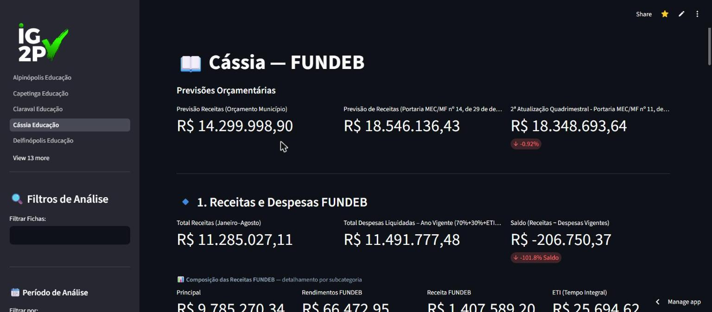
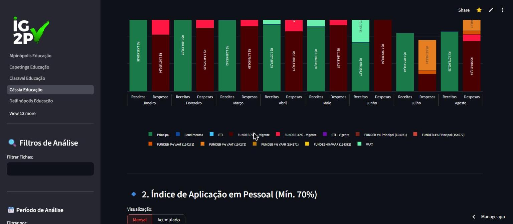

# iG2P Dashboards v4

> Financial management dashboards for Brazilian municipal governments (Minas Gerais and São Paulo) —
> live analysis of Education (FUNDEB), Health, and Intergovernmental Agreements (Convênios).



## 🇬🇧 Overview
iG2P is a multi-page analytics platform that turns each city hall's accounting spreadsheets into
clear, auditable dashboards. It reads **live** from each municipality's Google Sheets and renders
interactive views used by municipal secretaries to track how public money is applied against the
legal minimums.

### Key features
- **FUNDEB** — 70% (teacher payroll) and 4% (full-time education) application indexes, with
  monthly/accumulated views, legal targets, and period filters (bimester, semester, custom range).
- **Own Revenue (25%)** — minimum education investment index, with deductions and surplus handling.
- **Investment by category** — spending broken down by education level / health category and by
  funding source, with interactive filters.
- **School Meals & Transport, PDDE, Programs** — activity-level breakdowns per school.
- **Health & Convênios modules** — execution, funding sources, and transfers.
- Resilient data layer: tolerant tab/sheet matching, retry-with-backoff, request timeouts, and an
  API-authoritative-with-fallback policy so cities never show stale data silently.



### Tech stack
`Python` · `Streamlit` · `pandas` · `Plotly` · `gspread` (Google Sheets API) · deployed on Streamlit Cloud.

### Running locally
```bash
pip install -r requirements.txt
# add your own .streamlit/secrets.toml (service account + sheet IDs)
streamlit run Home.py
```
> Credentials (`secrets.toml`) are **git-ignored** and never committed.

---

## 🇧🇷 Visão geral
O iG2P é uma plataforma de dashboards que transforma as planilhas contábeis de cada prefeitura em
painéis claros e auditáveis. Lê os dados **ao vivo** das planilhas Google de cada município e gera
visões interativas usadas pelas secretarias para acompanhar a aplicação dos recursos públicos frente
aos mínimos legais.

### Principais recursos
- **FUNDEB** — índices de aplicação do 70% (folha do magistério) e do 4% (tempo integral), com visão
  mensal/acumulada, metas legais e filtros de período (bimestre, semestre, intervalo).
- **Recursos Próprios (25%)** — índice do mínimo em educação, com deduções e tratamento de superávit.
- **Investimento por categoria** — gasto por nível de ensino / categoria de saúde e por fonte de
  recurso, com filtros interativos.
- **Merenda e Transporte, PDDE, Programas** — detalhamento por atividade e por escola.
- **Módulos de Saúde e Convênios** — execução, fontes e repasses.
- Camada de dados resiliente: casamento tolerante de abas/planilhas, retry com backoff, timeout nas
  requisições e política de "API como fonte da verdade" com fallback.

### Tecnologias
`Python` · `Streamlit` · `pandas` · `Plotly` · `gspread` (API do Google Sheets) · deploy no Streamlit Cloud.

### Rodando localmente
```bash
pip install -r requirements.txt
# crie seu próprio .streamlit/secrets.toml (conta de serviço + IDs das planilhas)
streamlit run Home.py
```
> As credenciais (`secrets.toml`) ficam **fora do versionamento** e nunca são commitadas.
